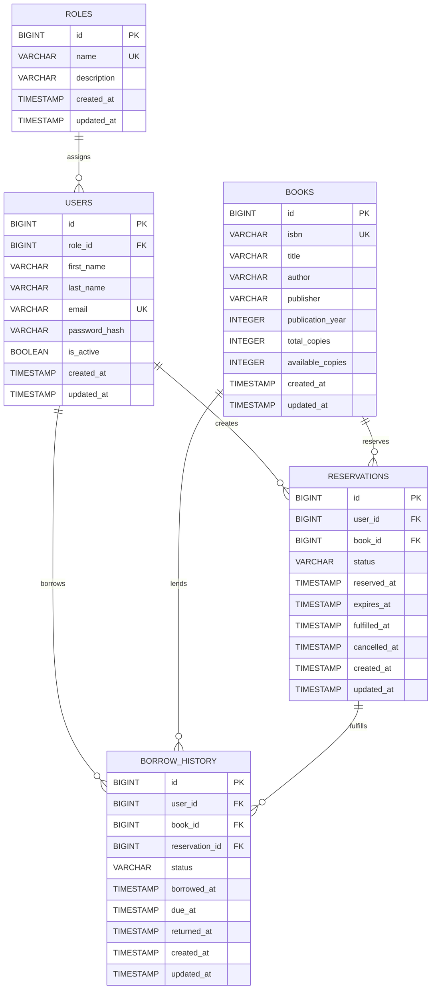

# java-projekt-Dudek-Galezowski
# Projekt: REST API Księgarni

Kompletne REST API do zarządzania zasobami biblioteki. Aplikacja umożliwia rejestrację użytkowników, przeglądanie katalogu książek, wypożyczanie, a także tworzenie rezerwacji. 
System posiada wbudowane mechanizmy bezpieczeństwa oparte na tokenach JWT oraz kontrolę dostępu bazującą na rolach.

## Realizacja wymogów formalnych projektu
Projekt został zrealizowany zgodnie z filarami programowania obiektowego oraz zasadami SOLID.

* Polimorfizm: Zaimplementowany poprzez stworzenie własnej hierarchii wyjątków biznesowych (m.in. `ResourceNotFoundException`) dziedziczących po `RuntimeException`.
* Wzorce projektowe: Builder (budowanie tokenów JWT w konfiguracji Spring Security), Repository (wzorzec dostępu do danych w Spring Data JPA), DTO (Data Transfer Object dla modeli zapytania), Dependency Injection (wstrzykiwanie przez konstruktory), oraz Filter/Chain of Responsibility (wykorzystane w JwtAuthenticationFilter przy filtrowaniu zapytań HTTP).
* RBAC (Role-Based Access Control): Pełny podział ról w systemie (ADMIN / READER) z zabezpieczeniem konkretnych endpointów.
* Testowanie: Zaimplementowano testy integracyjne przy użyciu narzędzi JUnit 5 oraz MockMvc. Do analizy pokrycia kodu skonfigurowano w środowisku Maven narzędzie JaCoCo.

## Technologie i narzędzia
* **Język:** Java 21
* **Framework:** Spring Boot 4.0.6 (Spring WebMVC, Spring Data JPA, Spring Security, Validation)
* **Baza danych i migracje:** PostgreSQL + Flyway
* **Autoryzacja (JWT):** Java JWT w wersji 0.12.6
* **Dokumentacja API:** SpringDoc OpenAPI 3 (Swagger UI) w wersji 3.0.3
* **Redukcja kodu:** Lombok
* **Testowanie i pokrycie kodu:** Spring Boot Starter Test (JUnit 5, Mockito) + plugin JaCoCo w wersji 0.8.13
* **Infrastruktura i budowanie:** Docker, Maven

## Instrukcja uruchomienia

Projekt posiada dwa kontenery, bazy danych 'Postgres' oraz aplikacji 'spring_backend' do uruchamiania w kontenerach Docker.

### Uruchomienie
```bash

#(Kontener bazy potrzebny aby testy podczas budowania przeszły)
docker compose up postgres -d
./mvnw clean package
docker compose up -d

```

Aplikacja będzie nasłuchiwać pod adresem: http://localhost:8080.

### Endpointy i Swagger

Interaktywna dokumentacja Swagger UI dostępna jest pod adresem:
http://localhost:8080/swagger-ui/index.html

#### Zrzuty ekranu
* [Swagger- endpoint1](Readme_Resources/endpoint1.png)
* [Swagger - endpoint2](Readme_Resources/endpoint2.png)

## ERD bazy danych
Poniższy diagram przedstawia dokładną strukturę tabel w bazie PostgreSQL.


